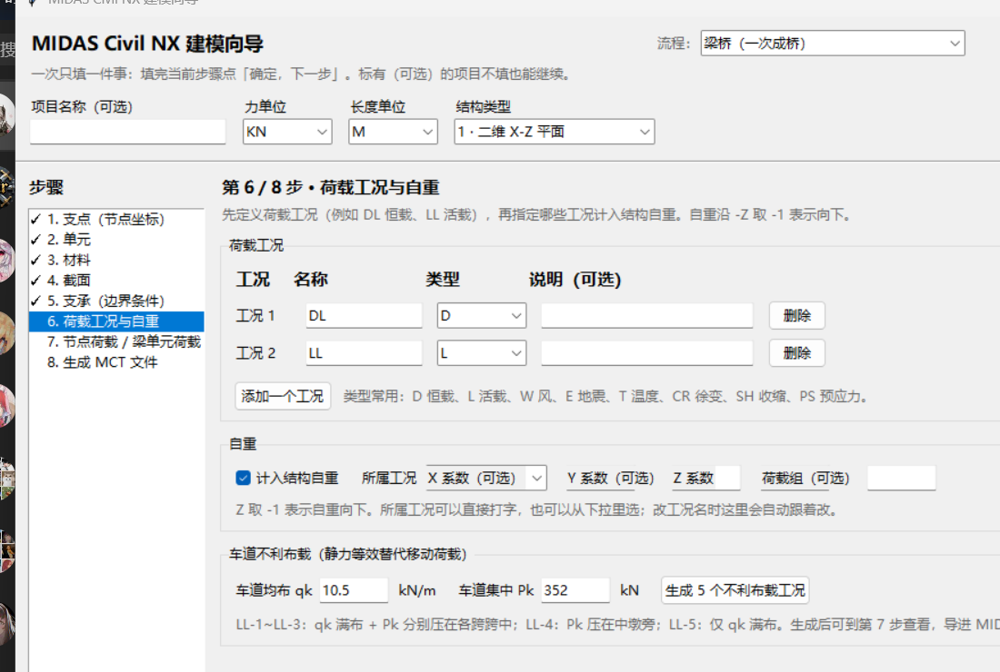
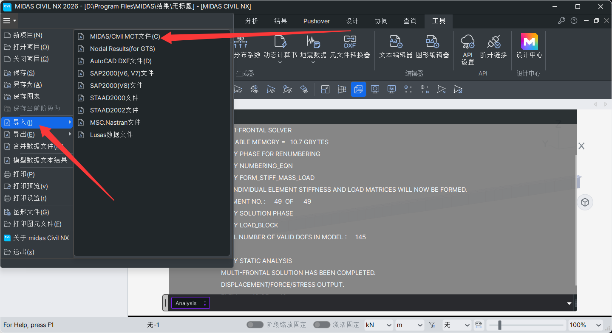
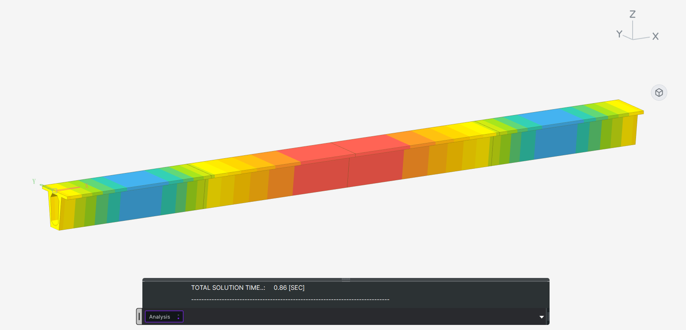
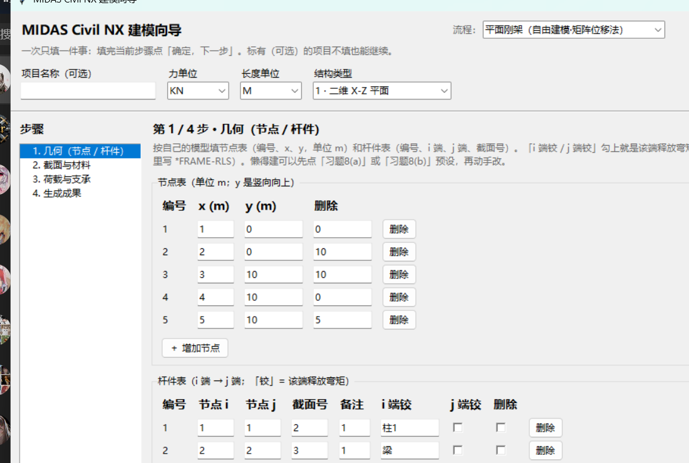
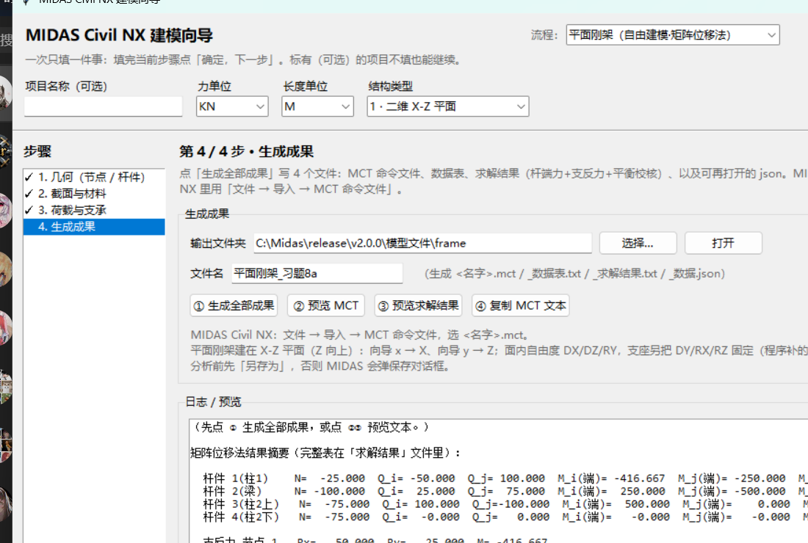
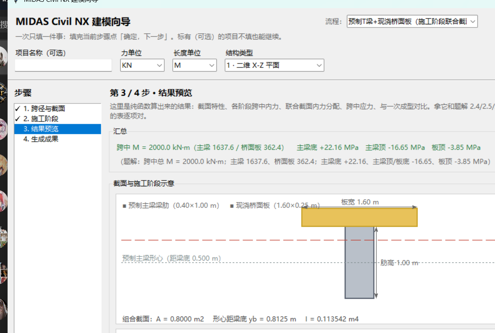
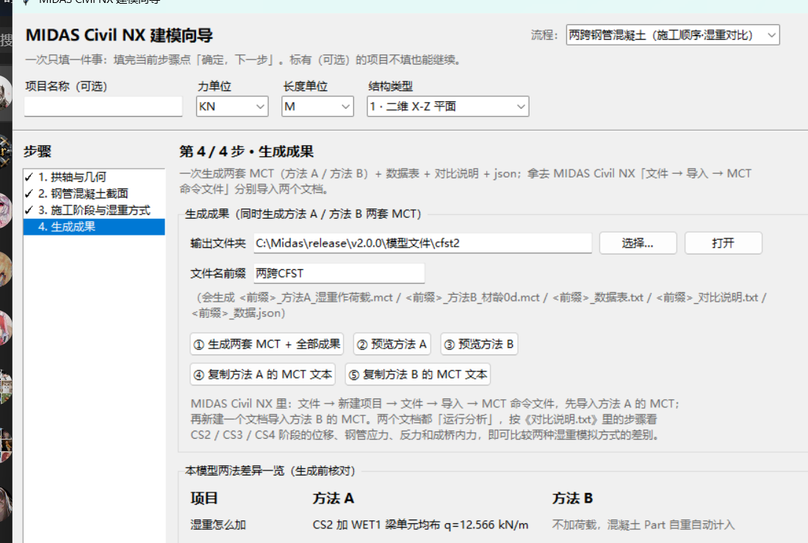

# midas-mct-wizard · MIDAS Civil NX 建模向导

一个不用学 MIDAS 就能建桥梁模型的桌面小工具。按步骤填表，最后生成一个 `.mct`
命令文件，在 MIDAS Civil NX 里 **文件 → 导入 → MCT 命令文件** 就能得到完整模型。

现在内置 **9 条建模流程**：梁桥 / 拱桥 / 斜拉桥 / 悬索桥 / 施工阶段梁桥 /
钢管混凝土拱 / 平面刚架 / 预制 T 梁 + 现浇桥面板 / 两跨钢管混凝土对比。

> **非官方工具。** 与 MIDAS IT 无隶属关系，也未获其认可或赞助。
> "MIDAS"、"MIDAS Civil NX" 是 MIDAS IT 的商标，本项目只是生成它支持的
> MCT 文本格式。

[](https://github.com/shi-zhong111/midas-mct-wizard/actions/workflows/ci.yml)


> 代码质量由 `tests/` 下的单元测试 + `--selftest` 保证，在 Windows / Linux / macOS
> 三平台 CI 上跑（见 `.github/workflows/ci.yml`）。

---

## 三步就能用起来

### ① 填表

左边是步骤，右边一次只显示一步。填完当前步点「确定，下一步」，
有问题底部会用红字告诉你缺什么。右上角「流程」下拉切换桥型。



### ② 把生成的 .mct 导入 MIDAS

最后一步点「生成成果」，得到 `.mct` 文件。在 MIDAS Civil NX 里
**文件 → 导入 → MIDAS/Civil MCT 文件**，选它就行。



### ③ 让 MIDAS 分析

导入完成就能直接运行分析，不需要再手动建任何东西。



> 上面三张图是一个变截面连续梁的例子：填表 → 导入 → 分析，
> 全程没在 MIDAS 里点过建模菜单。

---

## 9 条流程

所有流程都在同一个骨架里：顶部「流程」下拉切换，每条流程各自填数、各自存盘
（切流程/关窗口都不丢），最后都写 `.mct` + 数据表 + 导入说明。

| 代码 | 流程 | 步数 | 能做什么 | 对应课件 |
|---|---|---|---|---|
| `beam` | **梁桥（一次成桥）** | 8 | 支点/单元/材料/截面（含 DXF 自定义截面）/支承/工况/荷载；可选移动荷载·模态·屈曲 | 第 01～03 讲 |
| `arch` | **拱桥 · 施工阶段** | 4 | RC 拱桥：拱轴线 + 施工部件 + 施工阶段联合截面 + 收缩徐变；可选模态/屈曲 | 第 05 讲 |
| `cable` | **斜拉桥（鱼骨刺·成桥）** | 5 | 三跨双塔、单/双索面、TENSTR 索 + 初拉力、塔梁连接（固结/半飘浮/飘浮） | 第 03 讲 |
| `susp` | **悬索桥** | 5 | 主缆抛物线、吊杆、加劲梁、桥塔；H=wL²/(8f) 初拉力 | 第 03 讲 |
| `cs` | **施工阶段梁桥** | 5 | 连续刚构（悬臂浇筑）/ 简支变连续，湿重、体系转换、CEB-FIP 徐变 | 第 03/04 讲 |
| `cfst` | **钢管混凝土拱** | 4 | 架钢管 → 灌混凝土（湿重）→ 联合截面 → 二期；另给一次成拱对比 | 第 05 讲 |
| `frame` | **平面刚架（自由建模）** | 4 | 节点/杆件/支承/荷载自由建模，**内置矩阵位移法直接出杆端力、支反力**；端部释放（铰） | 第 02 讲 |
| `tbeam` | **预制 T 梁 + 现浇桥面板** | 4 | 20 m T 梁先架后浇，施工阶段联合截面（*STAGE + *CPOSECT4CS）+ 内力/应力结果 | 第 05 讲 |
| `cfst2` | **两跨钢管混凝土（湿重对比）** | 4 | 两跨同时施工，一次生成两套 MCT：湿重作荷载 / 混凝土材龄 0 d 激活 | 第 05 讲 |

---

## 新流程长什么样

平面刚架流程：第 1 步填节点/杆件表，第 4 步不用 MIDAS 就能看到矩阵位移法算出的杆端力。





预制 T 梁 + 现浇桥面板（第 3 步结果预览）和两跨钢管混凝土对比（第 4 步一次生成两套 MCT）：





---

## 这个工具解决什么问题

MIDAS Civil NX 功能很强，但上手要先学一堆概念：节点、单元、材料、截面、
边界组、荷载工况、梁单元荷载、施工阶段、联合截面…… 对只想把常规桥型建出来
的人来说，前半小时基本花在"找菜单"上。

这个向导把这件事变成填表：每一步只问一件事，填错了当场用红字告诉你哪里不对，
填完一键生成 MCT 文件导进 MIDAS。**不需要记命令、不需要点菜单、全程不联网。**

---

## 适配版本（先看这个）

程序生成的是 **MIDAS Civil NX** 的 MCT 命令文件。实测通过的版本：

| 版本 | 情况 |
|---|---|
| **MIDAS CIVIL NX 2025 (v1.1)**，`CVLw.exe` 文件版本 `25.09.16.1001` | ✅ 实测导入通过 |
| MIDAS Civil 2022 及更早 | ⚠️ 未实测。梁桥流程第 8 步勾选「备用写法」会换成旧版语法（`*UNIT` 两字段、`*MATERIAL` 无 `DAMPRATIO`、`*STRUCTYPE` 短格式），可自行尝试 |

> 「直连 MIDAS」三个按钮是**附带功能**，仅 Civil NX（带 Open API）可用，且要先在
> MIDAS 里点 **应用程序 → API 设置 → 连接**。本项目的主路径是离线生成 `.mct`。

程序里的 MCT 写法（材料行的 `STANDARD/CODE/DB/USEELAST`、`DBUSER` 截面
`OFFSET` 后那 6 个 `0`、DXF 一般截面的 `*SECT-PSCVALUE`、施工阶段的 `*STAGE` /
`*CPOSECT4CS`、索单元的 `TENSTR` / `*PRETENSION`）都是照着上面这个版本
自己导出的原文写的。

---

## 和同类工具的区别

MIDAS 相关的开源项目有好几个，但它们面向的都是"会写代码的人"。这个项目的
切入点不一样，选之前先对一下表：

| | **本项目** | [官方 midas-civil-python](https://github.com/MIDASIT-Co-Ltd/midas-civil-python) | [BHoM MidasCivil_Toolkit](https://github.com/BHoM/MidasCivil_Toolkit) | [midas-bridge-mcp](https://github.com/WWWeiZhang/midas-bridge-mcp) | [ifc2mct](https://github.com/1molPotato/ifc2mct) |
|---|---|---|---|---|---|
| 面向谁 | **不写代码的工程师** | 会 Python 的 | 用 BHoM 平台的 | 用 AI 助手的 | BIM 流程的 |
| 怎么用 | **双击 + 填表** | 写代码 | Grasshopper / 代码 | 自然语言 | 命令行 |
| 要装什么 | **什么都不用** | pip + 开 API | 整套 BHoM | pip + MCP + 开 API | Python |
| MIDAS 要开着吗 | **不用，离线出 .mct** | 必须 | 部分需要 | 必须 | 不用 |
| 任意 CAD 截面 | **✅ 读 DXF 轮廓** | 手动指定 | 有限 | 标准型钢 / 组合 | ❌ |
| 实测版本 | **Civil NX 2025** | 持续更新 | 到 2024 | NX | 2019 年后停更 |

一句话概括差别：**那几个工具都要你先"会点什么"，这个只要你会在表格里填数。**

另外，`midas-bridge-mcp` 和本项目的**「直连 MIDAS」功能是重叠的**——如果你的
MIDAS 开着 API、也习惯用 AI 助手，那个工具覆盖面更广，建议直接用它的。本项目的
主场景是**离线把 `.mct` 生成出来**，直连只是顺带的便利功能。

---

## 快速开始

### 方式一：双击启动（推荐）

下载仓库后双击 **`launch_wizard.bat`**。它会按顺序找 Python：

1. 之前用本程序装好的 Python
2. 系统里已有的 Python（`pyw` / `pythonw` / `py`）
3. 常见安装目录（`%LOCALAPPDATA%\Programs\Python\Python3*`、`C:\Python3*`、
   `%ProgramFiles%\Python3*`）——**装 Python 时没勾 "Add python.exe to PATH"
   也能找到**
4. 都没有 → **询问你**是否下载安装（约 25 MB，只从 python.org 下载，静默装到当前用户目录，不需要管理员）

> **你可以先自检**：装好 Python 后，把整个文件夹里的 `midas_wizard.py` 拖到一个
> 命令行窗口里回车，或者运行 `python midas_wizard.py --selftest`。
> 看到"自检完成，0 条失败"就说明环境没问题。真正的"一键启动"是双击 `launch_wizard.bat`。

普通 Windows 窗口程序，**不用浏览器、不联网**（只有你主动点"直连 MIDAS"或
同意安装 Python 时才会联网）。

### 方式二：命令行

```bat
python midas_wizard.py                          :: 打开界面
python midas_wizard.py --version                :: 看版本
python midas_wizard.py --list-flows             :: 列出全部流程（代码 + 名称）
python midas_wizard.py --selftest               :: 不打开界面，全部流程生成默认 MCT + 结构自检
python midas_wizard.py --emit-mct cfst2 --out 两跨CFST.mct   :: 用某流程的默认模型直接出 .mct
```

### 环境要求

- Windows 7 以上（主要开发/测试平台；纯计算部分也能在 Linux/macOS 跑，CI 会测）
- Python **3.9+**，自带 `tkinter`
- **零第三方依赖** —— 纯标准库，不用 `pip install` 任何东西

---

## 梁桥流程的 8 个步骤

左边是步骤栏，右边一次只显示一步。带「（可选）」的不填也能继续，
底部红字会告诉你当前步缺什么。

| 步骤 | 做什么 |
|---|---|
| **1. 支点** | 逐个填 X/Y/Z；也能「批量生成等间距支点」 |
| **2. 单元** | 每个单元连接两个支点；「依次连接相邻支点」自动生成连续梁 |
| **3. 材料** | 选规格（混凝土 C30~C60、钢材 Q235~Q460）自动带出弹模/泊松比/容重；也可用规范数据库或自定义数值 |
| **4. 截面** | 8 种参数化截面 + 变截面 + **CAD 自定义截面（DXF）** |
| **5. 支承** | 节点号 + 勾自由度；「首尾节点设为铰支座」一键两端铰支；可选节点连接（主从节点/弹性连接，含板式橡胶支座刚度计算器） |
| **6. 工况与自重** | 给荷载起名字（工况表）+ 定义结构自重；底部还能一键生成 **车道不利布载** |
| **7. 节点/梁单元荷载** | 所有荷载数值都在这一步填 |
| **8. 生成成果** | 写出 `.mct` + 数据 JSON + 数据表；页面下方「分析设置（可选）」可加移动荷载/模态/屈曲 |

### 亮点功能

- **9 条流程、一个界面**：右上角下拉切换桥型，各流程输入互不干扰、自动存盘。
- **内嵌求解器（平面刚架）**：不用 MIDAS，也能按第 02 讲的矩阵位移法把杆端力和支反力
  直接算出来（做作业、快速对答案用），并同时生成可导入 MIDAS 的 `.mct`。
- **施工阶段联合截面**：预制 T 梁 + 现浇桥面板、钢管混凝土拱、连续刚构等，
  直接生成 `*STAGE` + `*CPOSECT4CS`，阶段内力自动分配。
- **CAD 自定义截面**：直接把 DXF 轮廓读进来算面积、形心、Iyy、Izz、扭转常数，
  自动识别孔洞，写成 MIDAS 的**真正多边形一般截面**（`*SECT-PSCVALUE`）。
  支持闭合多段线、`LWPOLYLINE`、经典 `POLYLINE`+`VERTEX`、圆、圆弧、直线串。
- **车道不利布载**：按《公路桥涵设计通用规范》自动生成 5 个最不利布置工况
  （LL-1~LL-5），跨中位置按你的支承位置自动找，不用数节点号。
- **边填边校验**：生成前整体再查一遍，避免写出 MIDAS 导不进去的文件。
- **自动存档**：输入实时存到工作目录，关掉窗口不会丢。
- **名称可以用中文**：工况名、材料名、截面名直接写「自重」「二期」「主梁」就行，
  写进 MCT 的原样保留（配 GBK 编码），导入 MIDAS 后看到的还是中文，不用打拼音。
  唯一例外是**边界组名**——实测带中文会让整份导入失败，程序会自动去掉中文部分。
  名称里带**逗号**会被拦下：MCT 用逗号分隔字段，带了会让整行错位。

### 顺带的小功能（不是重点）

梁桥流程第 8 步还有「直连 MIDAS」三个按钮：MIDAS 开着并连上 Open API 时，
可以一键导入、让 MIDAS 分析、把反力位移取回来。

**这个功能请当作附赠**——MIDAS 官方的
[midas-civil-python](https://github.com/MIDASIT-Co-Ltd/midas-civil-python) 和
[midas-bridge-mcp](https://github.com/WWWeiZhang/midas-bridge-mcp) 在这件事上
覆盖面都更广。本项目的价值在于**离线把 `.mct` 生成出来**，不需要 MIDAS 在运行。

---

## 项目结构

```
midas-mct-wizard/
├─ midas_wizard.py              主程序外壳：流程下拉、步骤栏、导航、存盘、成果输出、命令行
├─ flow_api.py                  流程插件接口（FlowBase）
├─ wiz_common.py                公共数值/截面/DXF 解析（所有流程共用）
├─ sect_ui.py                   共用「截面库」界面（参数化 + DXF 自定义截面）
├─ analysis_core.py             移动荷载 / 模态 / 屈曲的 MCT 片段 + 校验
├─ mct_lint.py                  MCT 结构自检（引用检查 + 与真实样本字段数对照）
├─ arch_core.py                 拱桥引擎
├─ flow_cable.py / cable_core.py    斜拉桥
├─ flow_susp.py  / susp_core.py     悬索桥
├─ flow_cs.py    / cs_core.py       施工阶段梁桥
├─ flow_cfst.py  / cfst_core.py     钢管混凝土拱
├─ flow_frame.py / frame_core.py    平面刚架（含矩阵位移法求解器）
├─ flow_tbeam.py / tbeam_core.py    预制 T 梁 + 现浇桥面板（施工阶段联合截面）
├─ flow_cfst2.py / cfst2_core.py    两跨钢管混凝土（湿重两种模拟对比）
├─ 使用说明.txt                  给用户看的详细说明（GBK，Windows 记事本直接打开）
├─ launch_wizard.bat            Windows 启动器（UTF-8 with BOM + CRLF）
├─ .gitattributes               强制 .bat/.ps1 用 CRLF（cmd.exe 的硬要求）
├─ docs/                        界面截图
├─ scripts/
│   └─ install_python.ps1       首次运行时安装 Python（仅 python.org）
├─ examples/                    示例 .mct（梁桥/刚架/T梁/两跨CFST）+ DXF 图纸
├─ tests/
│   ├─ test_portable.py         跨平台单元测试（纯函数 + 全部流程默认 MCT）
│   └─ test_cross_platform.py   验证没有 winreg 也能 import（CI 跑 Linux/macOS）
├─ LICENSE                      MIT
└─ .github/workflows/ci.yml     CI：3 个平台 × Python 3.9 / 3.12
```

> **注意 `launch_wizard.bat` 的编码**：它必须保持 **UTF-8 with BOM + CRLF 换行**。
> `cmd.exe` 解析批处理时要求 CRLF，用 LF 换行会被解析错乱，报出
> `'em' is not recognized as an internal or external command` 这种莫名其妙的错，
> 表现出来就是"双击没反应"。`.gitattributes` 已经帮你锁住了，改这个文件时别动编码。

**为什么拆成多文件？** 从 2.0 开始，程序是「一个外壳 + 每条桥型一个流程插件」：
`midas_wizard.py` 只保留公共外壳（流程下拉、步骤栏、导航、会话存盘、成果按钮），
每种桥型的输入、校验、MCT 生成都在自己的 `flow_*.py` + `*_core.py` 里。
这样加一种桥型不用改主程序，引擎部分还能脱离界面单独测试。
整个文件夹仍然是绿色便携的：拷到 U 盘、换台电脑双击 `launch_wizard.bat` 就能跑。

---

## 跑测试

```bat
python -m unittest discover -s tests -v
python midas_wizard.py --selftest
```

测试只覆盖纯函数（截面特性、DXF 解析、MCT 生成、校验规则、数据模型）和
各流程的默认模型，**不启动 Tk、不连 MIDAS、不写工程目录**，所以
Windows / Linux / macOS 和 CI 上都能跑。

重点盯的是"算错了但看起来很正常"的地方，例如：

- 空心箱梁的**扭转常数**：旧写法直接套实心近似 `A⁴/(40·Ip)`，箱梁会差
  **1~3 个数量级**。现在空心走薄壁 Bredt 公式，实测与解析解相差 1~3%。
- CAD 截面画在离原点很远的位置（坐标 317321 这种）不能把惯矩算成垃圾值。
- 工况名在 `*STLDCASE` 和 `*USE-STLD` 里必须写成同一个名字，否则荷载整批丢掉。
- `nan` / `1e999` 这类输入不能把程序搞崩（`pythonw` 下没有控制台，报错看不见）。
- 坐标到 `1e308` 这种量级时不能抛 `OverflowError`（同样接不住、看不见）。
- 平面刚架求解器：6 个经典算例对解析解复核，另用 slope-deflection 手算解对照。
- 预制 T 梁联合截面：跨中总弯矩 2000 kN·m、主梁 1637.6 / 板 362.4 kN·m、
  跨中应力与手算一致。

启动器也实测过：在"Python 装在默认目录但没加 PATH"的机器上能找到并启动；
`launch_wizard.bat` 的 CRLF 编码有 `.gitattributes` 锁住，防止回到"双击没反应"。

---

## 相关项目

同一个领域的开源工具，按需取用：

- [MIDASIT-Co-Ltd/midas-civil-python](https://github.com/MIDASIT-Co-Ltd/midas-civil-python)
  —— MIDAS 官方的 Python 库（`pip install midas-civil`，MIT）。想用代码直接驱动
  Civil NX、批量跑分析取结果，用这个。
- [BHoM/MidasCivil_Toolkit](https://github.com/BHoM/MidasCivil_Toolkit)
  —— BHoM 平台的 MidasCivil 适配器（LGPL v3，C#）。已接入 BHoM/Grasshopper
  工作流的用它。
- [WWWeiZhang/midas-bridge-mcp](https://github.com/WWWeiZhang/midas-bridge-mcp)
  —— 让 AI 助手直接操控 Civil NX 的 MCP 服务器（MIT）。覆盖面比本项目的
  「直连 MIDAS」广得多。
- [1molPotato/ifc2mct](https://github.com/1molPotato/ifc2mct)
  —— IFC 模型转 MIDAS/Civil（2019 年后未更新）。
- [MIDAS 官方 MCT Command Shell 文档](https://support.midasuser.com/hc/ko/articles/18561873323289-MCT-Command-Shell)
  —— MCT 命令的字段依据。

---

## 免责声明

- **非官方**：本项目与 MIDAS IT 无任何隶属关系。使用时请遵守你的 MIDAS 许可协议。
- **请务必核对结果**：生成的模型导入 MIDAS 后，请自行核对支点坐标、单元连接、
  材料数据、截面尺寸与特性、支承、荷载工况与数值。工程计算结果请以 MIDAS
  自身算出的为准，本程序只负责"把模型建出来"。
- **扭转常数是近似值**：CAD 自定义截面的 `Ixx` 由轮廓近似算得（空心用薄壁
  Bredt 公式，实心用圣维南近似）；扭转敏感的分析请以 MIDAS 自己算的为准。
  导入后 MIDAS 会按多边形重算，以 MIDAS 的值为准。
- **新建的几条流程还没有真机导入实测**：移动荷载/模态/屈曲（实验功能）、
  `*FRAME-RLS` 端部释放、两跨钢管混凝土的两套湿重模型属于首次实测项。
  第一次导入如果报错，把 MIDAS 命令行窗口里的**行号**发 Issue，按行号改；
  急用就先取消对应选项、生成不带那一块的模型。
- **作者不对任何工程后果负责**，请自行复核。

---

## 参与贡献

欢迎提 Issue 和 PR。请先跑一遍 `python -m unittest discover -s tests` 和
`python midas_wizard.py --selftest`，确保都是绿的。

如果要把程序发给别人，直接把整个文件夹打包即可（绿色便携）；
`模型文件/` 是这个程序运行时自己建的工作目录，不用打包。

## 许可

[MIT](LICENSE)
